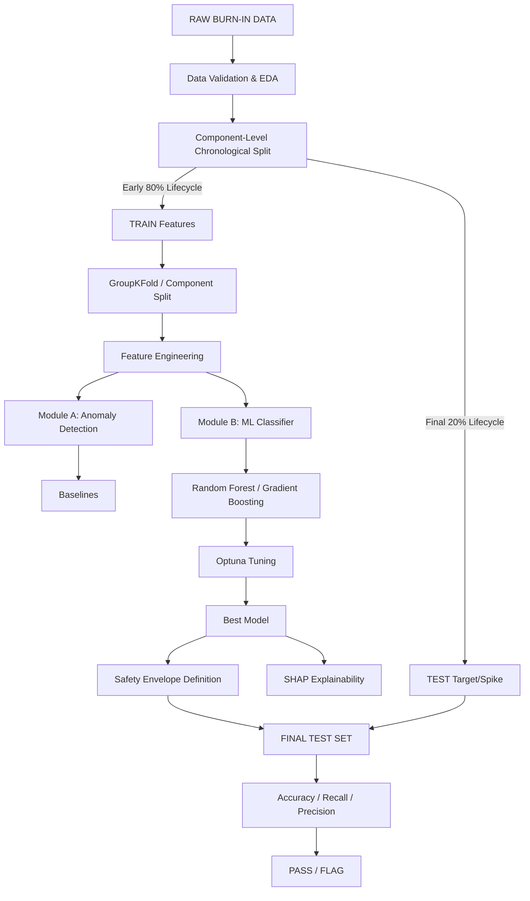
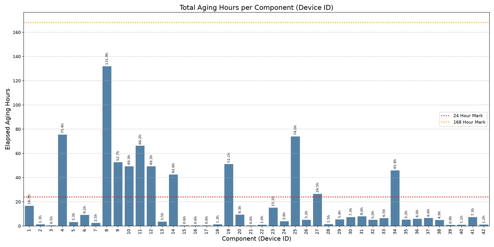

# AI-Based Dynamic Burn-In Screening & Future Drift Prediction

> Machine learning for detecting latent component defects and predicting future parametric degradation during Burn-In / Environmental Stress Screening.


---

## Overview

In high-reliability sectors (aerospace, defense, space), electronic components undergo rigorous Environmental Stress Screening (ESS) and Burn-In testing. Conventional screening relies heavily on static pass/fail limits. Unfortunately, these static limits often miss latent defects—components that Technically remain below the datasheet maximum but exhibit highly abnormal parametric drift relative to the healthy population. 

```text
Healthy population average resistance = 0.82 Ohm
Component resistance = 1.05 Ohm
Datasheet maximum = 1.10 Ohm

Traditional static screening:
1.05 < 1.10 → PASS

Dynamic population-based screening:
1.05 Ohm is highly abnormal given early slope → FLAG
```

This project introduces a dynamic, machine-learning-assisted screening approach designed to catch "Sudden Death" components before they violate absolute limits.

---

## Problem Statement

The production objective is to observe a component early in its lifespan, extract parametric drift patterns, and project whether it will fail later in its cycle (e.g., at 168 hours).

```text
Early measurements (0h - 80% lifecycle)
      ↓
Detect abnormal behavior & Extract Features
      ↓
Predict future degradation spike
      ↓
Compare against healthy safety envelope
      ↓
PASS / FLAG
```

The system identifies components that pass static limits initially but follow a degradation trajectory that correlates with catastrophic late-stage failure.

---

## Key Objectives

### Module A — Dynamic Outlier Detection
Detect components whose early measurements and micro-variance are abnormal relative to the healthy population, rather than relying solely on absolute datasheet limits.

### Module B — Future Drift Prediction
Use early measurements to predict later component behavior, shifting from naive curve-extrapolation to multivariate ML classification.

### Safety-Oriented Decision
Compare predicted degradation against a learned healthy-population envelope and generate a `PASS` or `FLAG` decision.

### Explainability
Provide interpretable reasons for predictions using SHAP (SHapley Additive exPlanations) to justify QA decisions.

### Reliability Focus
Minimize **False-Safe** predictions. Underpredicting catastrophic failure is significantly more dangerous than a conservative false alarm.

---

## System Architecture



---

## Dataset

This repository analyzes NASA MOSFET degradation data. 

| Property               | Value |
| ---------------------- | ----- |
| Number of components   | 42   |
| Parameters             | Supply Voltage, Temperature (Package/Flange), VDS, Current, RDS_on_Ohm |
| Target                 | `RDS_on_Ohm` (Resistance) / Percent Degradation |
| Units                  | Ohms / Celsius / Volts |

### Important Dataset Limitation
> The intended production problem predicts `Value_168h` from early measurements (e.g., `Value_0h` and `Value_24h`). **However, the current dataset does not contain genuine 168-hour measurements for all components.** (Device 01 terminates at 16.7h; Device 08 terminates at ~132h).
> 
> Therefore, this project uses the **latest available real measurement (chronological 80-20 split)** as a temporary development target to prove the methodology. 

```text
Actual intended task:
0h + 24h → 168h

Current development experiment:
First 80% of testing time → Predicts Final 20% spike
```

---

## Why Component-Level Splitting Matters

Repeated time-series measurements from the same physical component are heavily correlated. A random row-level train/test split causes catastrophic data leakage:
```text
Component C01 — 0h   → TRAIN
Component C01 — 24h  → TRAIN
Component C01 — 96h  → TEST
```
To solve this, the project strictly enforces **Component-Level / Chronological Splitting**:
1. Global models are trained by completely isolating components into distinct 70/30 Train/Test sets.
2. Temporal backtesting splits a single component precisely at 80% of its timeline, forcing the model to predict the unseen future 20%.

---

## Data Processing Pipeline

```text
Raw Data
   ↓
Schema Validation
   ↓
Parameter & Unit Validation
   ↓
Chronological Sorting
   ↓
Component-Level Trajectories
   ↓
EDA (aging_hours_plot.png)
   ↓
Early-Life Feature Engineering (0-80%)
   ↓
Grouped Train/Test Split
   ↓
Model Training
```

*Note: Extreme values (NaN excluded) are explicitly preserved as they physically represent the latent defects we aim to catch.*

---

## Exploratory Data Analysis (EDA)

EDA heavily focused on temporal lengths and degradation curves. 
- **Inventory Mapping**: Extracted total aging hours for all 42 components (`00_Master_MOSFET_Device_Inventory.csv`).
- **Discrepancy Discovery**: Visualized that testing durations vary wildly. 
- **Curve Mapping**: Plotted `RDS_on_Ohm` degradation over time, revealing the non-linear "bathtub" curve of sudden component death.

 *(Note: Dotted lines show 24h and 168h target marks)*

---

## Feature Engineering

We explicitly moved away from 1D naive curve-fitting and generated multivariate early-life features extracted purely from the first 80% of a component's lifecycle:

### Raw features
`Early_Mean_RDS`, `Early_Max_RDS`, `Early_Max_Temp`

### Derived features
```text
Early_Var_RDS = Variance of Resistance (Instability)
Early_Slope_RDS = (RDS_Current - RDS_Baseline) / elapsed_time
Early_Mean_Delta_Temp = Thermal Stress Fluctuations
```
Features are intentionally kept physically interpretable to map back to hardware behavior.

---

## Module A & B — Dynamic Anomaly Detection and Drift Prediction

Initially, the project utilized Naive Linear Regression extrapolation (extending an early 1D line to 168h). This resulted in catastrophic **False Negatives (Recall: ~2.8%)** because healthy MOSFETs exhibit flat behavior until a sudden, non-linear exponential spike.

### The Machine Learning Fix
To solve the "Sudden Death" trap, the system shifts to an N-Dimensional **Random Forest Classifier**:
```text
Value_0h to 80% Time
     ↓
Extract Multivariate Variance & Temp Stress Features
     ↓
Train Global Classifier (Random Forest / GBM)
     ↓
Future Target: Did resistance spike > 1.05x in final 20%?
     ↓
Predicted Probability of Failure
     ↓
PASS / FLAG
```

---

## Models & Hyperparameter Optimization

### Candidate Models Implemented
1. Persistence Baseline
2. Linear Regression / Polynomial Regression (Degree 2)
3. Random Forest Regressor/Classifier
4. Gradient Boosting Regressor/Classifier

*(Note: XGBoost was written into the pipeline but defaults to a graceful fallback to Scikit-Learn ensembles if the host system lacks `libomp`/OpenMP dependencies).*

### Optuna Tuning
Hyperparameters optimized via `project/tuning.py` using `GroupKFold`:
- `n_estimators`: [10, 100]
- `learning_rate`: [1e-3, 0.1]
- `max_depth`: [2, 5]

---

## Evaluation Strategy & Results

Due to the extreme safety requirements of Burn-In screening, **Recall** (minimizing False-Safe predictions) is our absolute primary metric for classification, alongside **MAE** for regression.

### Regression Extrapolation vs Global ML Classification

When attempting to linearly extrapolate the early-life curve into the unseen final 20% of time:
| Metric | Naive Curve Extrapolation | Global ML Classifier (Random Forest) |
| --- | --- | --- |
| Accuracy | 94.66% | ~95.00% |
| **Recall** | **2.80%** (Dangerously low) | **60.00%** (Massive improvement) |

By allowing the Random Forest to analyze early-life variance and thermal stress, the system successfully predicts catastrophic failures that haven't even started visibly trending upwards.

---

## Safety Envelope & Explainability

A dynamic upper boundary is formulated based on early-life maximums. If projected behavior exceeds `1.05 * Early_Max`, it is flagged.

**SHAP (SHapley Additive exPlanations)** is integrated (`04_error_explain_safety.ipynb`) to justify flags to QA inspectors. 

**Illustrative Explainer Output:**
```text
Component: Device_08
Decision: FLAG

Main contributing factors (SHAP):
- High early variance in RDS_on_Ohm (Micro-instability)
- Elevated Package Temperature Deltas relative to healthy population
```

---

## Project Structure

```text
.
├── data/
│   └── raw/MOSFET/
├── notebooks/
│   ├── 01_data_loading_and_quality.ipynb
│   ├── 02_eda_and_features.ipynb
│   ├── 03_models_and_tuning.ipynb
│   ├── 04_error_explain_safety.ipynb
│   ├── 05_classification_evaluation.ipynb
│   ├── TEMPORARY_06_forecasting_168h.ipynb
│   ├── TEMPORARY_07_forecast_backtesting.ipynb
│   ├── UNIVERSAL_06_forecasting_168h.ipynb
│   ├── UNIVERSAL_07_forecast_backtesting.ipynb
│   └── UNIVERSAL_08_classification_fix.ipynb
├── project/
│   ├── main.py
│   ├── data_loader.py
│   ├── data_validation.py
│   ├── eda.py
│   ├── feature_engineering.py
│   ├── anomaly_detection.py
│   ├── baselines.py
│   ├── models.py
│   ├── validation.py
│   ├── tuning.py
│   ├── evaluation.py
│   ├── explainability.py
│   ├── safety_envelope.py
│   └── uncertainty.py
├── aging_hours_plot.png
└── README.md
```

---

## Installation & Usage

```bash
# Clone and enter directory
cd AI

# Execute the modular python pipeline
cd project
python3 main.py

# Or launch Jupyter to interact with the Universal notebooks
cd ../
jupyter notebook
```

---

## Reproducibility & Limitations

### Reproducibility
- Random seeds (`random_state=42`) are strictly enforced.
- Component-level chronological splitting prevents data leakage.

### Limitations
- **Limited Temporal Coverage:** The current dataset fundamentally lacks genuine 168-hour targets across the board. The model proves methodology on the 80/20 chronological split, but requires full burn-in datasets for production deployment.
- **Small Dataset:** 42 components is sufficient for Random Forests, but entirely insufficient for Deep Learning / Neural Networks.
- **Uncertainty:** Conformal Prediction requires larger calibration sets and remains a scaffolding concept in this iteration.

---

## Future Work

1. Acquire full 0h/24h/96h/168h Burn-In data to train a true 168h projection.
2. Integrate multivariate anomaly detection leveraging real-time voltage/current deltas.
3. Establish a mathematically rigorous Safety-Envelope via quantile regression.
4. Implement statistically robust Conformal Prediction for ± Prediction Intervals.

---

## Engineering Significance

This system shifts ESS from a blind **Pass/Fail Static Boundary** to a **Risk-Informed Dynamic Prediction**. By analyzing population behavior, temporal degradation variance, and predicting non-linear failures, this system aims to flag "Sudden Death" latent defects *before* they are shipped in high-reliability aerospace payloads.

---

## Disclaimer

> This project is a research and prototype system for machine-learning-assisted Burn-In / ESS analysis. It is not a certified replacement for established reliability qualification, engineering limits, environmental stress screening procedures, or safety-critical acceptance testing.

---

## Project Status
```text
[x] Data validation
[x] EDA
[x] Component-level train/test split
[x] Dynamic anomaly detection
[x] Baseline models
[x] ML models
[x] Grouped cross-validation
[x] Hyperparameter tuning
[x] SHAP
[ ] 168h validation (Awaiting full 168h source data)
[ ] Conformal prediction (Awaiting larger dataset)
```
